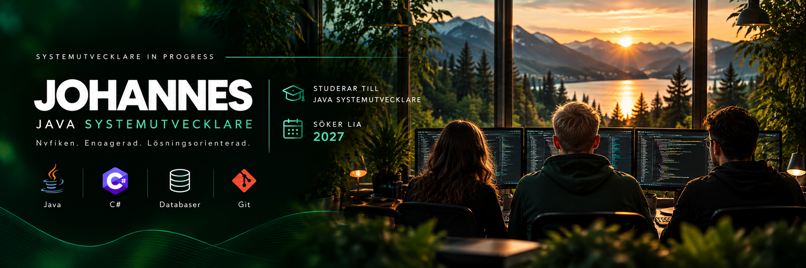

  

<!-- ═══════════════ BANNER ═══════════════ -->

  

  
  

<h1 align="center">Hej, jag heter Johannes 👋</h1>

  <strong>Java Systemutvecklare under utbildning</strong>
   
  YH Akademin · Stockholm / Göteborg

  Jag gillar problemlösning, smarta lösningar och att bygga programvara som fungerar.
   
  Nu utvecklar jag mina kunskaper och söker en LIA-plats inför november 2027.

  
  
  

---

<!-- ═══════════════ PROFILKORT ═══════════════ -->

<table>
<tr>
<td width="55%" valign="top">

## 👨‍💻 Profil

Jag studerar systemutveckling med Java-inriktning på **YH Akademin**, där jag började i augusti 2026.

Jag är nyfiken, noggrann och lösningsorienterad. Jag gillar att förstå hur system fungerar, arbeta strukturerat och lära mig genom praktiska projekt.

🎯 **Mitt mål:** att utvecklas inom Java backend och bidra i ett professionellt utvecklingsteam.

</td>
<td width="45%" valign="top">

## 🚀 LIA 2027

**Start:** November 2027

**Omfattning:** 24 veckor

**Plats:** Stockholm eller Göteborg

**Inriktning:** Java backend

 

</td>
</tr>
</table>

---

<!-- ═══════════════ TECH STACK ═══════════════ -->

<h2 align="center">⚡ TECH STACK</h2>

  

  
  
  

  Kunskaperna utvecklas löpande genom utbildning och projekt.

---

<!-- ═══════════════ GITHUB STATS – MITTEN ═══════════════ -->

<h2 align="center">📊 GITHUB ANALYTICS</h2>

  <i>Min utveckling, aktivitet och kod över tid.</i>

  
  

  

---

<!-- ═══════════════ PROJEKT ═══════════════ -->

<h2 align="center">🚨 UTVALT PROJEKT</h2>

<table>
<tr>
<td width="100%" valign="top">

### Larmsystem med sensorer

Ett programmeringsprojekt där jag arbetar med logiken för ett larmsystem och regler för aktivering av sensorer.

- **Systemstyrning:** aktivera larmsystemet och enskilda sensorer.
- **Särskild regel:** röksensorn ska alltid kunna aktiveras, oavsett övrig systemstatus.
- **Fokus:** villkor, problemlösning och hur systemkomponenter samverkar.

  
  
  

<a href="DIN_PROJEKTLÄNK_HÄR">↗ Visa projektet på GitHub</a>

</td>
</tr>
</table>

---

<!-- ═══════════════ STYRKOR & MÅL ═══════════════ -->

<table>
<tr>
<td width="50%" valign="top">

## 💡 Mina styrkor

- 🔍 Problemlösning
- 🎯 Noggrann och strukturerad
- 🤝 Bra på samarbete
- 🚀 Engagerad och driven
- 🌱 Nyfiken och lärande
- 💭 Kreativ i mitt sätt att lösa problem

</td>
<td width="50%" valign="top">

## 🎯 Nästa steg

- ☕ Fördjupa mig i Java backend
- 🗄️ Utveckla mina databaskunskaper
- 🧪 Lära mig mer om testning och kodkvalitet
- 👥 Få erfarenhet av professionella utvecklingsteam
- 💻 Bygga fler projekt till min portfolio

</td>
</tr>
</table>

---

<!-- ═══════════════ KONTAKT ═══════════════ -->

<h2 align="center">🤝 LET'S BUILD SOMETHING</h2>

  Söker ni en engagerad LIA-student inom Java backend inför november 2027?
   
  Jag berättar gärna mer om min utbildning och mina projekt.

  
  
  

  Learning · Building · Improving — one commit at a time. 🌱

